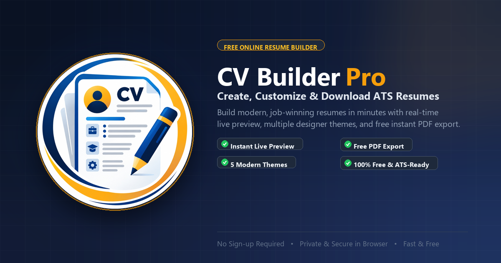

<p align="center">
  
</p>

<h1 align="center">CV Builder Pro</h1>

<p align="center">
  <strong>A modern, free, and privacy-first resume builder designed to create job-winning, ATS-friendly resumes in minutes.</strong>
</p>

<p align="center">
  <a href="#-key-features">Key Features</a> •
  <a href="#-designer-templates">Templates</a> •
  <a href="#-tech-stack">Tech Stack</a> •
  <a href="#-getting-started">Getting Started</a> •
  <a href="#-exporting-to-pdf">PDF Export</a> •
  <a href="#-metadata--social-sharing">Social Sharing</a>
</p>

<p align="center">
  
  
  
  
  
  
  
</p>

---

<p align="center">
  
</p>

---

## 📖 Overview

**CV Builder Pro** is a high-performance web application designed for professionals and students seeking a seamless, distraction-free way to create polished, ATS-optimized CVs and resumes. 

Unlike traditional subscription-based builders that lock your downloads behind paywalls, **CV Builder Pro is 100% free, runs entirely inside your browser, and auto-saves your progress locally**.

---

## ✨ Key Features

- ⚡ **Real-Time Live Preview**: Dynamic, proportional A4 canvas scaling with zero lag as you type.
- 🎨 **5 Designer Templates**: Switch effortlessly between **Modern**, **Classical**, **Standard**, **Minimalist**, and **Elegant** designs with one click.
- 🔀 **Drag-and-Drop Reordering**: Intuitively reorder sections and nested items (experience, education, skills, projects) using `@dnd-kit/sortable`.
- 🎛️ **Modular Sections**: Toggle sections on or off as needed:
  - 👤 **Personal Details** (Avatar, Designation, Contact, Socials)
  - 🛠️ **Skills & Technical Proficiencies**
  - 💼 **Work Experience**
  - 🎓 **Education & Academic Background**
  - 🚀 **Projects & Portfolios**
  - 📜 **Certifications & Licenses**
  - 🌐 **Languages & Fluency**
  - 🏆 **Awards & Honors**
  - 👥 **References**
  - 🎨 **Hobbies & Interests**
- 📄 **True Vector PDF Export**: High-resolution, vector-crisp PDF output using a dedicated `@media print` stylesheet. Text remains selectable, search-friendly, and sharp.
- 💾 **Local-First Auto-Save**: Powered by **Zustand with `localStorage` persistence**—no data loss when refreshing or closing the browser.
- ↔️ **Resizable Sidebar Controls**: Fluid, draggable sidebar separator allowing you to customize your workspace layout comfortably.
- 🔒 **100% Client-Side Privacy**: No user data, avatars, or credentials leave your device. Zero analytics tracking or remote databases.
- 📱 **Social Sharing & WhatsApp Ready**: Comprehensive Open Graph and Twitter Card tags with an optimized (< 250 KB) high-contrast preview banner for WhatsApp, LinkedIn, Discord, and Facebook.

---

## 🎨 Designer Templates

| Template | Aesthetic | Best Suited For |
| :--- | :--- | :--- |
| **Modern** | Clean two-column layout with sidebar accent and visual hierarchy | Software Engineers, Tech, Design |
| **Classical** | Timeless serif typography, centered headings, and traditional lines | Legal, Academia, Medical, Finance |
| **Standard** | Clean, structured single-column format optimized for ATS parsers | Corporate, Project Management, Sales |
| **Minimalist** | Generous whitespace, refined sans-serif fonts, and subtle divider rules | Creative Directors, UX/UI, Marketing |
| **Elegant** | Sophisticated header accent styling with balanced horizontal flow | Executives, Consultants, Senior Leadership |

---

## 🛠️ Tech Stack

- **Framework**: [React 19](https://react.dev/)
- **Build Tool**: [Vite 8](https://vitejs.dev/) with Fast HMR
- **Language**: [TypeScript](https://www.typescriptlang.org/)
- **Styling**: [Tailwind CSS 3.4](https://tailwindcss.com/) & [PostCSS](https://postcss.org/)
- **State Management**: [Zustand 5](https://github.com/pmndrs/zustand) with `persist` middleware
- **Drag & Drop**: [@dnd-kit/core](https://dndkit.com/) & [@dnd-kit/sortable](https://dndkit.com/)
- **Icons**: [Lucide React](https://lucide.dev/)
- **Rich Text & Inputs**: [React Dropzone](https://react-dropzone.js.org/) & [React Quill New](https://github.com/alexpermyakov/react-quill-new)
- **Animations**: [Framer Motion](https://www.framer.com/motion/)

---

## 📁 Project Structure

```text
cv-builder/
├── public/
│   ├── android-chrome-192x192.png  # PWA standard icon
│   ├── android-chrome-512x512.png  # PWA high-res icon
│   ├── apple-touch-icon.png        # iOS home screen bookmark icon
│   ├── favicon.ico                 # Multi-resolution ICO (16/32/48)
│   ├── favicon.svg                 # Scalable vector favicon
│   ├── logo.png                    # Transparent master logo (1024x1024)
│   ├── og-image.png                # WhatsApp & Social Media banner (1200x630, <250KB)
│   ├── og-image-square.png         # Square social thumbnail (600x600)
│   └── site.webmanifest            # Progressive Web App manifest
├── src/
│   ├── assets/                     # Static graphical assets
│   ├── components/
│   │   ├── forms/                  # Section input modules (Profile, Experience, Skills...)
│   │   └── preview/                # Live A4 CV preview & modular templates
│   │       └── templates/          # Modern, Classical, Standard, Minimalist, Elegant
│   ├── lib/                        # Utility helpers and clsx/tailwind-merge
│   ├── pages/
│   │   └── CVBuilder.tsx           # Main workspace layout with resizer & navigation
│   ├── store/
│   │   └── cvStore.ts              # Zustand store with persistent local storage
│   ├── types/
│   │   └── cv.ts                   # TypeScript interfaces and data models
│   ├── utils/
│   │   └── exportPdf.ts            # PDF export handler
│   ├── App.tsx                     # Root component
│   ├── index.css                   # Global styles & @media print pagination engine
│   └── main.tsx                    # React DOM entry point
├── index.html                      # SEO, Open Graph & device metadata
├── package.json                    # Project dependencies and npm scripts
├── tailwind.config.js              # Custom Tailwind configuration
├── tsconfig.json                   # TypeScript compiler options
└── vite.config.ts                  # Vite plugin configuration
```

---

## 🚀 Getting Started

### Prerequisites

Ensure you have [Node.js](https://nodejs.org/) (version 18 or newer) installed.

### Installation

1. **Clone the repository**:
   ```bash
   git clone https://github.com/your-username/cv-builder.git
   cd cv-builder
   ```

2. **Install dependencies**:
   ```bash
   npm install
   ```

3. **Start the local development server**:
   ```bash
   npm run dev
   ```

4. Open your browser and navigate to `http://localhost:5173`.

---

## 📜 Available Scripts

| Command | Action |
| :--- | :--- |
| `npm run dev` | Runs the Vite development server with hot module replacement (HMR). |
| `npm run build` | Compiles TypeScript and builds an optimized production bundle into `dist/`. |
| `npm run preview` | Locally serves the production build from `dist/` for testing. |
| `npm run lint` | Runs ESLint to check for code quality and formatting issues. |

---

## 📄 Exporting to PDF

CV Builder Pro utilizes the browser's native print engine with custom pagination logic in [index.css](file:///c:/Users/USER/Desktop/Mobile%20App%20Dev/cv-builder/src/index.css) to generate high-resolution, vector-based PDFs without third-party canvas degradation.

### Recommended Print Settings:
1. Click **Export PDF** in the top navigation bar.
2. In the browser print dialog:
   - **Destination**: Choose `Save as PDF`.
   - **Paper Size**: Set to `A4` (or `Letter`).
   - **Margins**: Select `None` or `Default`.
   - **Options**: Ensure **Background graphics** is **checked** (to preserve template colors, borders, and skill tags).
3. Click **Save**.

---

## 🌐 Metadata & Social Sharing

When sharing the link on **WhatsApp**, **Facebook**, **LinkedIn**, or **Twitter/X**, the application automatically displays:

- **Site Title**: `CV Builder Pro | Free Professional Resume Maker & PDF Export`
- **Description**: Concise summary highlighting ATS-friendly design and instant PDF export.
- **Preview Banner**: `public/og-image.png` (1200 × 630 px, engineered under 250 KB to comply with WhatsApp's strict 300 KB image scraper limit).
- **Apple Touch & Favicon Icons**: Custom-crafted anti-aliased circular badges for all devices and resolutions.

> **Production Deployment Tip**: When deploying to production (e.g. Vercel, Netlify, or a custom domain), update the `content="/og-image.png"` tag in [index.html](file:///c:/Users/USER/Desktop/Mobile%20App%20Dev/cv-builder/index.html) to your live absolute URL (e.g. `https://yourdomain.com/og-image.png`) so all external crawlers can resolve the image instantly.

---

## 🔒 Privacy & Security

- **No Remote Storage**: Resumes are generated entirely in the client's memory and stored only in your browser's `localStorage`.
- **Zero Third-Party Tracking**: No cookies, analytics trackers, or fingerprinting scripts are loaded.
- **Safe & Private**: Clearing browser data removes all stored resume content.

---

## 🤝 Contributing

Contributions are welcome! If you would like to add a new template, improve ATS compatibility, or fix a bug:

1. Fork the Project.
2. Create your Feature Branch (`git checkout -b feature/AmazingTemplate`).
3. Commit your Changes (`git commit -m 'Add AmazingTemplate'`).
4. Push to the Branch (`git push origin feature/AmazingTemplate`).
5. Open a Pull Request.

---

## 📄 License

Distributed under the **MIT License**. See `LICENSE` for more information.
